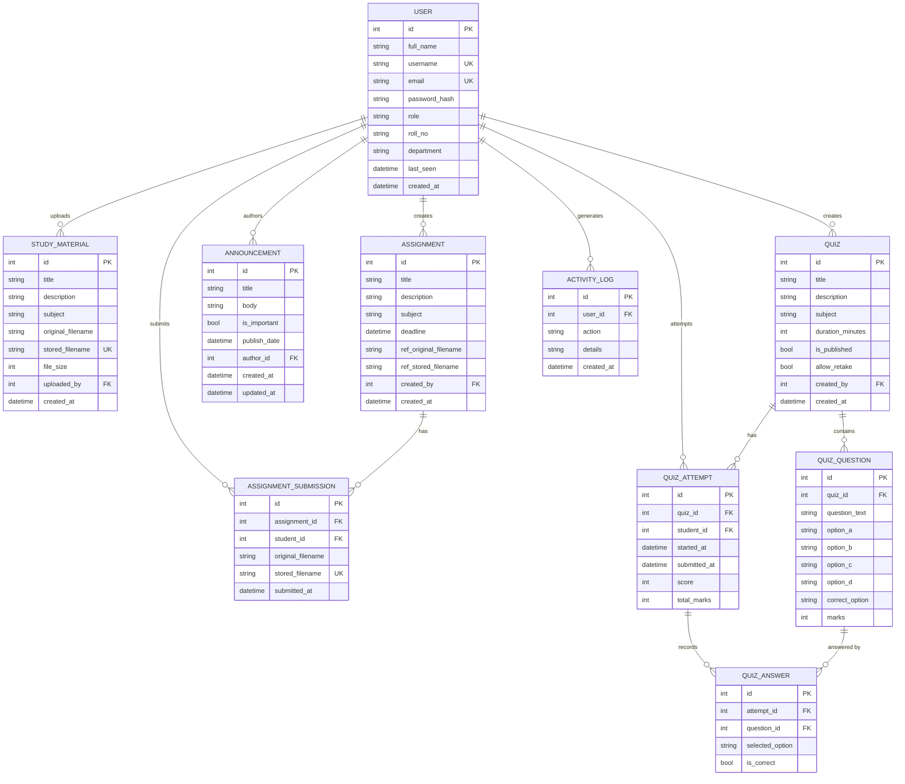

# CampusConnect – Entity-Relationship Diagram

## Table purposes

| Table | Purpose |
|-------|---------|
| `user` | All accounts (students and teachers). Role field enforces RBAC. |
| `study_material` | Metadata for uploaded files. Actual files are on disk under UUID names. |
| `assignment` | Homework posted by teachers with a deadline. |
| `assignment_submission` | One row per student per assignment. Unique constraint prevents duplicates. |
| `announcement` | Notice board posts. `is_important` pins them to the top. |
| `quiz` | Quiz metadata. `is_published` controls student visibility. |
| `quiz_question` | MCQ questions. `correct_option` is NEVER sent to student browsers before submission. |
| `quiz_attempt` | Records when a student started and submitted a quiz, plus their computed score. |
| `quiz_answer` | The option a student chose for each question in an attempt. |
| `activity_log` | Audit trail for logins, uploads, submissions, etc. Used by Network Status page. |
